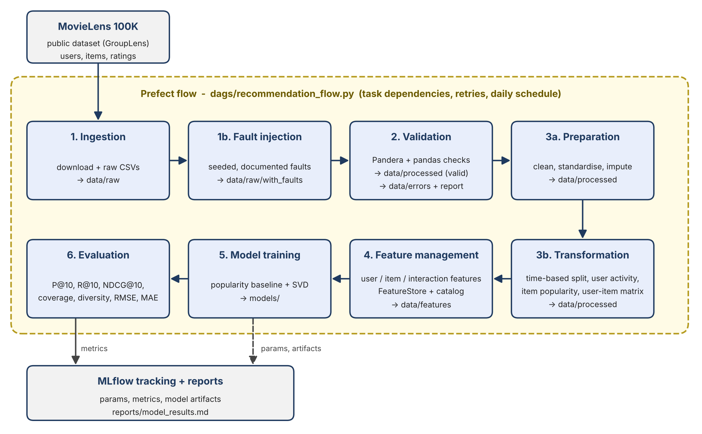

# End-to-End Data Management Pipeline for a Recommendation System

DM4ML Assignment 2. A modular, reproducible pipeline on MovieLens 100K:
ingestion -> validation -> preparation -> transformation -> feature management -> model training (MLflow) -> evaluation, orchestrated with Prefect.



## Quick start

Requires Python 3.11 and git. The first run downloads MovieLens 100K, so it needs an internet connection.

**Linux / macOS**

```bash
git clone https://github.com/krithi113/recommendation-pipeline.git
cd recommendation-pipeline
python3.11 -m venv .venv
source .venv/bin/activate                  # or: uv venv --python 3.11
pip install -r requirements.txt

python dags/recommendation_flow.py         # runs the whole pipeline once
```

**Windows (Command Prompt)**

```bat
git clone https://github.com/krithi113/recommendation-pipeline.git
cd recommendation-pipeline
py -3.11 -m venv .venv
.venv\Scripts\activate
pip install -r requirements.txt

set PYTHONUTF8=1
python dags\recommendation_flow.py
```


The pipeline was run from a fresh clone on Ubuntu and on Windows with identical results.

Optional UIs (use separate terminals, each with the virtual environment activated):

| Step | Linux / macOS | Windows (Command Prompt) |
|---|---|---|
| MLflow UI (http://127.0.0.1:5000) | `mlflow ui --backend-store-uri sqlite:///mlflow.db` | `mlflow ui --backend-store-uri sqlite:///mlflow.db` |
| Prefect UI (http://127.0.0.1:4200) | `prefect server start` | `prefect server start` |
| Point the flow at it | `export PREFECT_API_URL=http://127.0.0.1:4200/api` | `set PREFECT_API_URL=http://127.0.0.1:4200/api` |
| Run with the daily 02:00 schedule | `python dags/recommendation_flow.py --serve` | `python dags\recommendation_flow.py --serve` |

Without a running Prefect server, the flow starts a temporary one and stops it when the run ends, so the run link in the log will not open afterwards.

Each stage can also be run alone, in order:

```bash
python -m src.ingestion.ingest
python -m src.ingestion.inject_faults
python -m src.validation.validate
python -m src.preparation.prepare
python -m src.transformation.transform
python -m src.features.build_features
python -m src.training.train
python -m src.evaluation.evaluate
```

All settings (paths, seed, thresholds, K, model hyper-parameters) are in `configs/config.yaml`.

## Project structure

```
configs/config.yaml          all parameters
dags/recommendation_flow.py  Prefect flow (orchestration)
src/ingestion/               download + raw CSVs; seeded fault injection
src/validation/              Pandera + pandas checks, error rows, validation report
src/preparation/             cleaning, standardisation, imputation
src/transformation/          time-based split, user activity, item popularity, user-item matrix
src/features/                feature registry, FeatureStore, feature catalog
src/training/                popularity baseline, PureSVD, MLflow logging
src/evaluation/              ranking / rating metrics, results table
data/{raw,processed,features,errors}   pipeline outputs
models/                      saved models
reports/                     validation report, feature catalog, model results, diagram, screenshots
```

## Pipeline stages

| Stage | What it does | Main outputs |
|---|---|---|
| Ingestion | Downloads MovieLens 100K, writes raw CSVs (skips download if present, retries on failure) | `data/raw/*.csv` |
| Fault injection | MovieLens is clean, so a seeded (42) step injects documented faults to exercise validation | `data/raw/with_faults/`, `reports/fault_injection_log.json` |
| Validation | Schema, range, null, type, duplicate and referential-integrity checks. Bad rows are kept with their first failing reason | `data/processed/valid_*.parquet`, `data/errors/*_errors.csv`, `reports/validation_report.md` |
| Preparation | Standardise strings, age groups, parse release dates, impute missing release year (median), dedupe | `data/processed/clean_*.parquet` |
| Transformation | Time-based split (latest 20% = test), user activity summary, item popularity, sparse user-item matrix. All derived from train only | `train/test.parquet`, `user_item_matrix.npz` |
| Feature management | User, item and interaction features in an offline FeatureStore with versioned metadata and an auto-generated catalog | `data/features/`, `reports/feature_catalog.md` |
| Training | Popularity baseline and PureSVD (20 factors), params and artifacts logged to MLflow | `models/*.joblib`, `mlflow.db` |
| Evaluation | Precision@10, Recall@10, NDCG@10, coverage, diversity, RMSE, MAE; metrics logged to the same MLflow runs | `reports/model_results.md` |

### Design decisions

- **No leakage:** split is by time; the code asserts `max(train.ts) <= cutoff < min(test.ts)`. Features, popularity and the matrix use train rows only.
- **Evaluation protocol:** warm users and items only (cold-start is reported, not hidden); an item is relevant if test rating >= 4; metrics are averaged over users with at least one relevant test item.
- **Feature store:** the registry in `src/features/feature_definitions.py` drives both the data and the catalog, and an assertion keeps them in sync.

## Results (K = 10)

| model | precision@10 | recall@10 | ndcg@10 | coverage | diversity | rmse | mae |
|---|---|---|---|---|---|---|---|
| popularity_baseline | 0.1105 | 0.0867 | 0.1381 | 0.0464 | 0.7491 | 1.0373 | 0.8336 |
| svd_matrix_factorization | 0.1200 | 0.1285 | 0.1781 | 0.1560 | 0.7254 | 1.1503 | 0.9251 |

Evaluated on 95 users and 2,863 warm test rows. SVD is better on recall, NDCG and coverage. The precision gap is within the standard error across users, so it is not conclusive. The popularity baseline predicts ratings better (RMSE/MAE).

## Limitations

- Time-based split leaves 192 test users and 67 items unseen in training; they are excluded from evaluation and not handled by the models.
- The evaluation set is small (95 users), so differences between models are noisy.
- The FeatureStore is a simple offline parquet store, not an online serving system.
- Faults are injected synthetically, so detection rates reflect that injection design.
