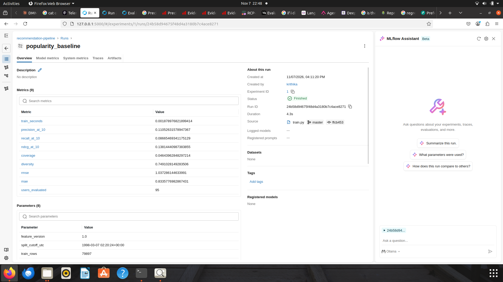
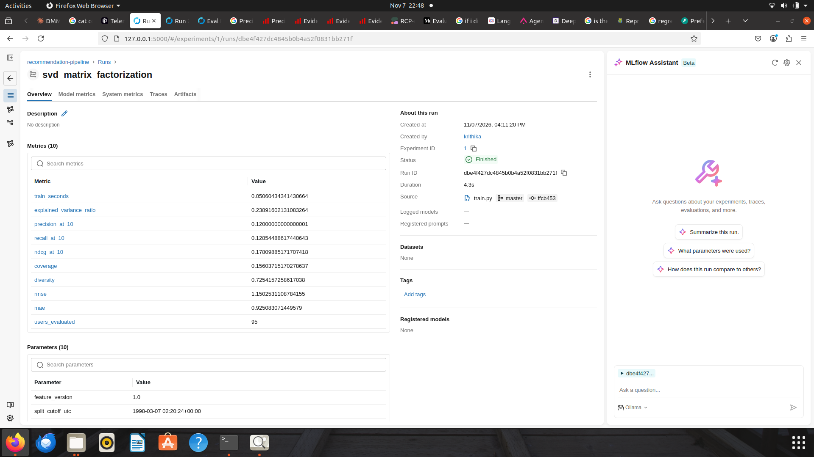
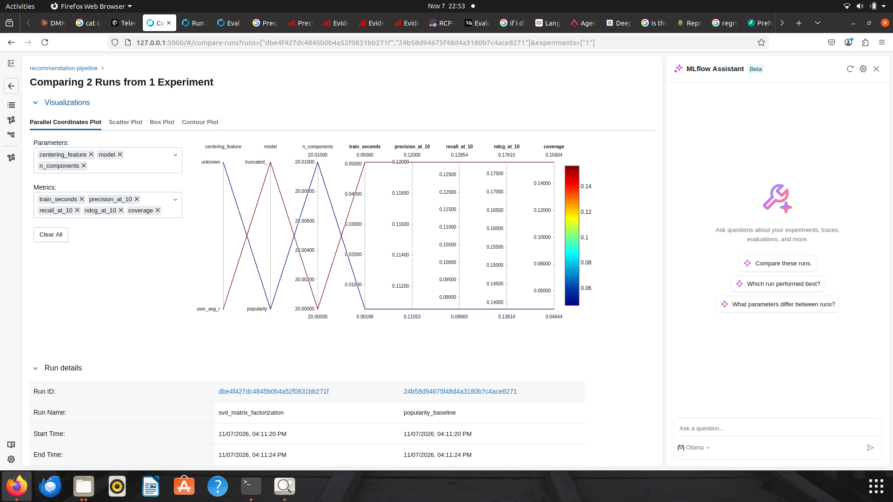

# Evidence

This page maps each assignment requirement to the file or screenshot that proves it. All numbers below come from real runs of the pipeline: one on Ubuntu (7 Nov 2026) and one from a fresh clone on Windows (14 Nov 2026). Both runs gave identical results.

## 1. Requirement checklist

| Requirement | Evidence in this repo |
|---|---|
| Modular source code | `src/` (ingestion, validation, preparation, transformation, features, training, evaluation) |
| Setup and execution instructions | `README.md` (Linux, macOS and Windows) |
| Pinned dependencies | `requirements.txt` |
| Architecture diagram | `reports/architecture.png` |
| Data validation report or logs | `reports/validation_report.md`, `reports/validation_summary.json`, `data/errors/*.csv`, `reports/logs/pipeline.log` |
| Feature catalog in table format | `reports/feature_catalog.md`, `data/features/feature_catalog.csv` |
| Model evaluation results for both models | `reports/model_results.md`, `reports/model_results.csv`, `reports/model_comparison.md` |
| Orchestration workflow file | `dags/recommendation_flow.py` (Prefect flow `recommendation-pipeline`) |
| Screenshot of a successful run | Section 3 below |
| Experiment tracking (MLflow) | Section 3 below |
| Final report (2-3 pages) | `reports/report.docx` and the PDF submitted on Taxila |

## 2. Evidence per stage (from the pipeline log)

| Stage | What the log shows |
|---|---|
| 1. Ingestion | `Ingested users=943 items=1682 interactions=100000` |
| 1b. Fault injection (seed 42) | `users=956 items=1689 interactions=100050` after injecting documented faults (`reports/fault_injection_log.json`) |
| 2. Validation | users: 956 in, 943 valid, 13 rejected. items: 1689 in, 1682 valid, 7 rejected. interactions: 100050 in, 99870 valid, 180 rejected. Every rejection count equals the injected count (`reports/validation_report.md`) |
| 3. Preparation | `Prepared: users=943 items=1682 interactions=99870`. One missing release year imputed with the median |
| 3b. Transformation | Time-based split at 1998-03-07: train 79,897 rows, test 19,973 rows. User-item matrix 751 x 1,615, sparsity 0.9341 (`reports/split_info.json`) |
| 4. Feature management | Feature store v1.0: 943 user, 1,682 item and 79,897 interaction feature rows (`data/features/`, `reports/feature_catalog.md`) |
| 5. Training | Popularity baseline and SVD (20 factors, explained variance 0.239), both logged to MLflow |
| 6. Evaluation | 95 users and 2,863 warm test rows at K = 10 (`reports/model_results.md`) |

Rejected rows by reason (users / items / interactions) are listed in `reports/validation_report.md`. The cold-start counts (192 test users and 67 test items not seen in training) are in `reports/split_info.json`.

## 3. Screenshots

All screenshots are in `reports/screenshots/`.

**Prefect: successful run of the orchestration flow.** All 8 task runs finished in state Completed, in dependency order.

**MLflow: popularity baseline run.** Parameters and metrics (precision@10, recall@10, ndcg@10, coverage, diversity, RMSE, MAE) are logged.

**MLflow: SVD run.** Same metrics, plus the explained variance of the latent factors.

**MLflow: comparison of the two runs.** Parameters and metrics side by side.

## 4. Reproducibility

| Run | Date | Machine | Result |
|---|---|---|---|
| Original | 7 Nov 2026 | Ubuntu, Python 3.11 | All 8 tasks completed |
| Clean-clone test | 14 Nov 2026 | Windows, fresh clone, `pip install -r requirements.txt` | All 8 tasks completed with identical row counts, split date, cold-start counts and metrics |

The run is repeatable because of a fixed seed (42), pinned versions and a single configuration file (`configs/config.yaml`).
